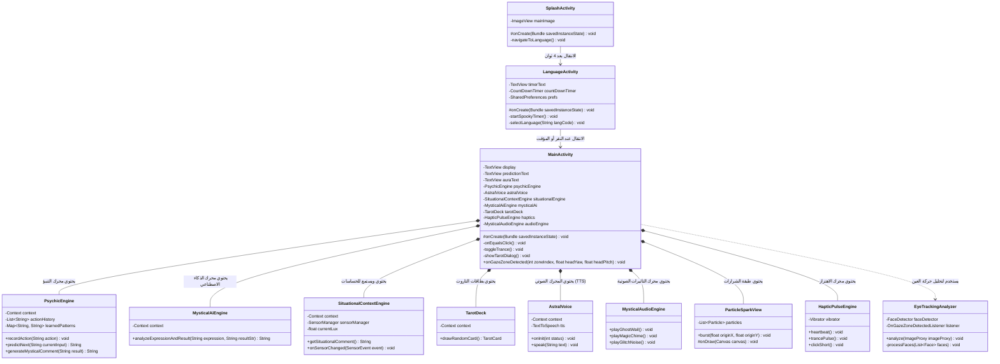

# 🧩 مخطط فئات UML وشرح تفصيلي: تطبيق "الحاسبة الروحانية"

---

## 1. مخطط الفئات (Mermaid classDiagram)

---

## 2. تشبيه بسيط: "العرض السحري" 🎪
- **`SplashActivity`**: "الستارة" — تكبر الصورة خلال 4 ثوانٍ.
- **`LanguageActivity`**: "حارس البوابة" — يعد 5 ثوانٍ ويسأل عن اللغة.
- **`MainActivity`**: "المخرج الرئيسي" — يقود العرض على المسرح.
- **`PsychicEngine`**: "قارئ الأفكار" — يتنبأ بالزر التالي.
- **`MysticalAiEngine`**: "الكوميديان" — يعلق على الحسابات.
- **`SituationalContextEngine`**: "المراقب" — يشعر بالإضاءة والبطارية.
- **`TarotDeck`**: "العرافة" — تسحب بطاقات التاروت.
- **`AstralVoice`**: "الشبح" — يهمس بالتوقعات.
- **`MysticalAudioEngine`**: "مهندس الصوت" — يصدر عويل الأرواح.
- **`ParticleSparkView`**: "خبير الألعاب النارية" — يطلق الشرارات السحرية.
- **`HapticPulseEngine`**: "نبض القلب" — ينبض بالاهتزاز.

---

## ❓ أسئلة للمراجعة الذاتية
1. لماذا تم وضع توليد صوت الأرواح في `MysticalAudioEngine` بدلاً من `MainActivity`؟
2. ماذا يحدث إذا حذفנו `finish()` في `SplashActivity`؟
3. ما هي الفئة التي يجب تعديلها لإضافة بطاقة تاروت جديدة؟
