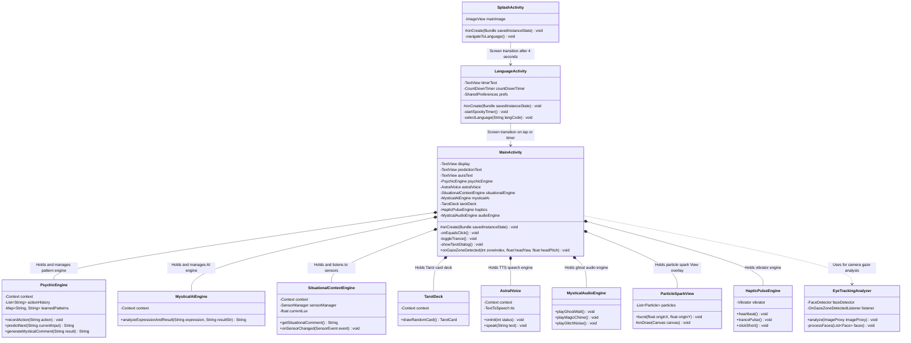

# 🧩 UML Class Diagram & Detailed Explanation: "Psychic Calculator" App

---

## 1. Class Diagram (Mermaid classDiagram)

---

## 2. Diagram Legend

| Symbol / Element | Meaning |
|---|---|
| **Class Box** | Represents one class in Java (`MainActivity`, `PsychicEngine`, etc.). |
| **Top Section** | Class name. |
| **Middle Section** | Fields / Variables stored in the class. |
| **Bottom Section** | Methods / Actions the class performs. |
| **`-` (Minus)** | `private` visibility — accessible only within this class. |
| **`+` (Plus)** | `public` visibility — accessible from other classes. |
| **`#` (Hash)** | `protected` visibility — used in Android lifecycle methods. |
| **`-->` Arrow** | Screen navigation via `Intent`. |
| **`*--` Composition** | Holds and owns the inner engine object. |
| **`..>` Dependency** | "Uses" — calls services of another class. |

---

## 3. 📖 Explanation in Simple Words

### Everyday Analogy: "Magic Circus Show" 🎪
- **`SplashActivity`**: "The Opening Gong" — lights swell up over 4 seconds declaring the show start.
- **`LanguageActivity`**: "The Gatekeeper" — counts down 5 seconds asking for your language.
- **`MainActivity`**: "The Ringmaster" — stands on stage directing all performers.
- **`PsychicEngine`**: "The Mind Reader" — predicts your next move.
- **`MysticalAiEngine`**: "The Stand-up Comedian" — makes hilarious remarks about your math.
- **`SituationalContextEngine`**: "The Crowd Observer" — watches light, battery, and 3 AM hours.
- **`TarotDeck`**: "The Fortune Teller" — draws astral Tarot cards.
- **`AstralVoice`**: "The Whispering Phantom" — speaks predictions in deep whispers.
- **`MysticalAudioEngine`**: "The Sound Engineer" — synthesizes ghost wails and magic chimes.
- **`ParticleSparkView`**: "The Pyrotechnician" — shoots magic sparks across the screen.
- **`HapticPulseEngine`**: "The Heartbeat" — pulses vibration in your hand.

---

## ❓ Self-Check Questions
1. Why is ghost sound generation placed in `MysticalAudioEngine` instead of `MainActivity`?
2. What happens if we omit `finish()` in `SplashActivity`?
3. Which class in the diagram needs modification if we want to add a new Tarot card?
4. Which class processes front camera frames for gaze detection?
