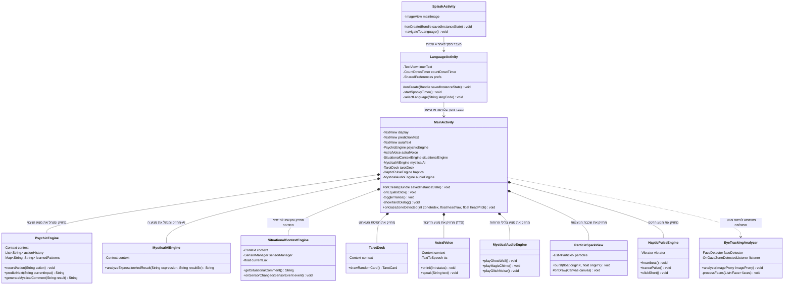

# 🧩 דיאגרמת מחלקות UML והסבר מפורט: אפליקציית «מחשבון פסיכי» (Psychic Calculator)

---

## 1. דיאגרמת מחלקות (Mermaid classDiagram)



---

## 2. מקרא: איך לקרוא את הדיאגרמה

| מה בדיאגרמה | מה זה אומר |
|---|---|
| **מלבן (Class)** | מייצג מחלקה אחת בתוכנית (למשל `MainActivity` או `PsychicEngine`). |
| **חלק עליון במלבן** | שם המחלקה. |
| **חלק אמצעי במלבן** | משתנים (שדות) שהמחלקה שומרת בתוכה. |
| **חלק תחתון במלבן** | מתודות (פעולות) שהמחלקה יודעת לבצע. |
| **סימן `-` (מינוס)** | משתנה/מתודה פרטית (`private`) — גישה מותרת רק מתוך מחלקה זו. |
| **סימן `+` (פלוס)** | משתנה/מתודה ציבורית (`public`) — מחלקות אחרות יכולות לקרוא לה. |
| **סימן `#` (סולמית)** | מתודה מוגנת (`protected`) — בשימוש במחזורי חיים של אנדרואיד. |
| **חץ רגיל `-->`** | מעבר בין מסכים באמצעות `Intent`. |
| **חץ מעוין מלא `*--`** | הרכבה (Composition) — המחלקה הראשית מחזיקה ומנהלת את הרכיב המוכל. |
| **חץ מקווקו `..>`** | תלות ("משתמש ב-") — המחלקה קוראת לשירותיה של מחלקה אחרת. |

---

## 3. 📖 הסבר במילים פשוטות

### הרעיון المרכזי
כל מחלקה בתוכנית אחראית על **תפקיד אחד בלבד** (עקרון האחריות היחידה). המסך הראשי אינו מחשב הסתברויות, אינו מייצר צלילי שמע בסינוסים ואינו קורא קלפים בעצמו — הוא פשוט "מנצח על התזמורת" ומפעיל מנועים ייעודיים.

### אנלוגיה יומיומית: "מופע קרקס וקסמים" 🎪
- **`SplashActivity`**: "הכרזת הפתיחה" — הפרוזקטור נפתח לאט לאט במשך 4 שניות ומכריז על תחילת המופע.
- **`LanguageActivity`**: "שומר הסף" — סופר 5 שניות לאחור עם פעמון ורוטט, ושואל באיזו שפה תרצה את המופע.
- **`MainActivity`**: "במאי המופע" — עומד במרכז הבמה, מקבל את הלחיצות, מציג את התוצאות ומפעיל את כל האמנים.
- **`PsychicEngine`**: "קורא המחשבות" — זוכר איזה מקשים לחצת ומנחש מה תהיה לחיצתך הבאה.
- **`MysticalAiEngine`**: "הסטנדאפיסט" — מעיר הערות מצחיקות ושנונות על כל חישוב (מזהיר מחורים שחורים כשמחלקים ב-0).
- **`SituationalContextEngine`**: "הצופה בקהל" — מסתכל אם חשוך בחדר, אם 3 לפנות בוקר או אם הסוללה נגמרת.
- **`TarotDeck`**: "מגלת העתידות" — שולפת קלף גורל אקראי עם עצת חיים.
- **`AstralVoice`**: "הלוחש בחושך" — מקריא את התחזיות בלחישה מפחידה ואיטית.
- **`MysticalAudioEngine`**: "טכנאי הסאונד" — מייצר יללות רוחות, צלצולי קסם וגלייצ'ים.
- **`ParticleSparkView`**: "מפעיל הזיקוקין" — מתיז ניצוצות וזיקוקים צבעוניים על המסך.
- **`HapticPulseEngine`**: "פעימת הלב" — מרעיד את הטלפון ביד כמו דופק חי.

---

### קבוצות המחלקות ותפקידיהן

#### **קבוצת המסכים (UI Activities)**
1. **`SplashActivity`**: מציגה את הלוגו המוגדל מנקודה לרוחב מלא במשך 4 שניות ➔ קשורה ל-`LanguageActivity`.
2. **`LanguageActivity`**: מנהלת את בחירת השפה והספירה לאחור המפחידה של 5 שניות ➔ קשורה ל-`MainActivity`.
3. **`MainActivity`**: הבמאי הראשי. מנהל את כפתורי המחשבון, התצוגה ומצב הטראנס ➔ קשור לכל המנועים.

#### **קבוצת הלוגיקה והמנועים (Engines & Logic)**
4. **`PsychicEngine`**: שומר את ההיסטוריה `actionHistory` ➔ מנבא את הכפתור הבא.
5. **`MysticalAiEngine`**: מנתח את התרגיל והתוצאה ➔ מפיק תגובות שנונות.
6. **`SituationalContextEngine`**: מודד חיישני תאורה וסוללה ➔ מפיק הערות הקשר.
7. **`TarotDeck`**: מחזיק את חפיסת הקלפים ➔ שולף קלף אקראי (`drawRandomCard`).

#### **קבוצת המדיה והאפקטים (Media & Visuals)**
8. **`AstralVoice`**: מנהל את ה-TextToSpeech בטון 0.42 ומהירות 0.60 ➔ הקראת טקסט.
9. **`MysticalAudioEngine`**: מסנתז צלילי PCM בזמן אמת ב-`AudioTrack` ➔ השמעת יללות וגלייצ'ים.
10. **`EyeTrackingAnalyzer`**: מנתח פריימים במצלמה ב-ML Kit Face Detection ➔ מזהה רביעיית מבט.
11. **`ParticleSparkView`**: מצייר ניצוצות עפים ב-Canvas ➔ אפקט חגיגי בחישוב.
12. **`HapticPulseEngine`**: מפעיל את מנוע הרטט (`Vibrator`) ➔ דפוס פעימת לב.

---

### איך לקרוא את החצים בדיאגרמה

- **`SplashActivity --> LanguageActivity`**: מסך הספלאש מעביר את המשתמש למסך בחירת השפה באמצעות `Intent` בתום 4 שניות.
- **`LanguageActivity --> MainActivity`**: מסך בחירת השפה מעביר את המשתמש למחשבון הראשי בתום 5 שניות או בלחיצה.
- **`MainActivity *-- PsychicEngine`**: המסך הראשי מחזיק בתוכו את מנוע ניבוי התבניות כחלק בלתי נפרד ממנו.
- **`MainActivity *-- MysticalAiEngine`**: המסך הראשי מחזיק את מנוע תגובות ה-AI כדי לנתח תוצאות.
- **`MainActivity *-- SituationalContextEngine`**: המסך הראשי מחזיק את מנוע החיישנים כדי לבדוק אור וסוללה.
- **`MainActivity *-- TarotDeck`**: המסך הראשי מחזיק את חפיסת קלפי הטארוט.
- **`MainActivity *-- AstralVoice`**: המסך הראשי מחזיק את מנוע הקול להקראת תחזיות.
- **`MainActivity *-- MysticalAudioEngine`**: המסך הראשי מחזיק את מנוע הסאונד להשמעת יללות.
- **`MainActivity *-- ParticleSparkView`**: המסך הראשי מחזיק את שכבת הניצוצות על הלוח.
- **`MainActivity *-- HapticPulseEngine`**: המסך הראשי מחזיק את מנוע הרטט לפעימות.
- **`MainActivity ..> EyeTrackingAnalyzer`**: המסך הראשי משתמש באנלייזר של המצלמה לצורך זיהוי מבט במצב טראנס.

---

### קשר לקוד: איך זה נראה ב-Java

**1. הרכבה (Composition / שדה במחלקה):**
```java
public class MainActivity extends AppCompatActivity {
    private PsychicEngine psychicEngine; // MainActivity מחזיקה את המנוע
    
    @Override
    protected void onCreate(Bundle savedInstanceState) {
        psychicEngine = new PsychicEngine(this);
    }
}
```

**2. מעבר בין מסכים (`Intent`):**
```java
Intent intent = new Intent(SplashActivity.this, LanguageActivity.class);
startActivity(intent);
finish();
```

---

### מה חשוב לזכור
1. **הפרדת אחריות (Separation of Concerns):** כתיבת תוכנית נכונה דורשת חלוקה למחלקות קטנות, כאשר כל אחת עושה דבר אחד מצוין.
2. **למה משתמשים ב-`private` (-):** כדי למנוע ממחלקות אחרות לשנות שדות פנימיים בטעות וליצור באגים.
3. **תלות (`..>`) מול הרכבה (`*--`):** הרכבה אומרת "הרכיב הוא חלק מיוצר המחלקה", בעוד תלות אומרת "אני פשוט קורא לו לצורך משימה זמנית".

---

### טעויות נפוצות של תלמידים
1. **לכתוב את כל הקוד ב-`MainActivity`:** זו שגיאה נפוצה. אם לא מפרידים למחלקות (`PsychicEngine`, `AstralVoice`), הקוד הופך למסורבל ומסובך לתחזוקה.
2. **לבלבל בין חץ הורשה (`extends`) לחץ תלות (`..>`):** חץ הורשה אומר "אני סוג של", וחץ תלות אומר "אני משתמש ב-".

---

## ❓ שאלות לבדיקה עצמית

1. **שאלה:** למה קוד יצירת צלילי הרוחות נמצא ב-`MysticalAudioEngine` ולא בתוך `MainActivity`?
2. **שאלה:** מה יקרה אם נמחק את הקריאה ל-`finish()` ב-`SplashActivity`?
3. **שאלה:** אם נרצה להוסיף קלף טארוט חדש לאפליקציה, באיזו מחלקה בדיאגרמה עלינו לערוך את הקוד?
4. **שאלה:** איזו מחלקה בדיאגרמה אחראית על עיבוד הפריימים של המצלמה הקדמית?
