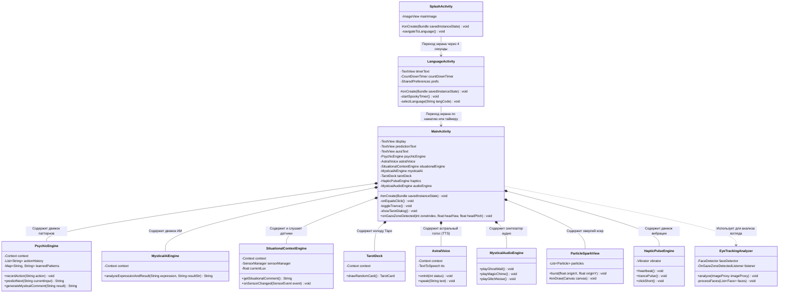

# 🧩 Диаграмма классов UML и подробное объяснение: «Калькулятор-Экстрасенс»

---

## 1. Диаграмма классов (Mermaid classDiagram)

---

## 2. Простая аналогия: «Магический цирк» 🎪
- **`SplashActivity`**: "Занавес" — картинка плавно увеличивается из точки за 4 секунды.
- **`LanguageActivity`**: "Страж ворот" — отсчитывает 5 секунд и спрашивает язык.
- **`MainActivity`**: "Конферансье" — главный артист на сцене.
- **`PsychicEngine`**: "Чтец мыслей" — угадывает следующую кнопку.
- **`MysticalAiEngine`**: "Шутник" — комментирует вычисления.
- **`SituationalContextEngine`**: "Зритель в зале" — видит темноту и заряд батареи.
- **`TarotDeck`**: "Гадалка" — достает карты Таро.
- **`AstralVoice`**: "Призрак" — шепчет предсказания.
- **`MysticalAudioEngine`**: "Звукорежиссер" — издает вопль привидения.
- **`ParticleSparkView`**: "Пиротехник" — пускает искры.
- **`HapticPulseEngine`**: "Сердцебиение" — пульсирует вибрацией.

---

## ❓ Вопросы для самопроверки
1. Почему синтез звуков вынесен в `MysticalAudioEngine`, а не написан внутри `MainActivity`?
2. Что произойдет, если убрать `finish()` в `SplashActivity`?
3. В каком классе нужно изменить код, чтобы добавить новую карту Таро?
